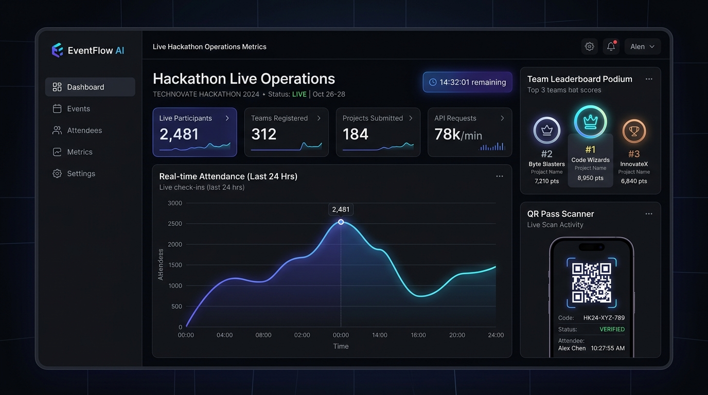
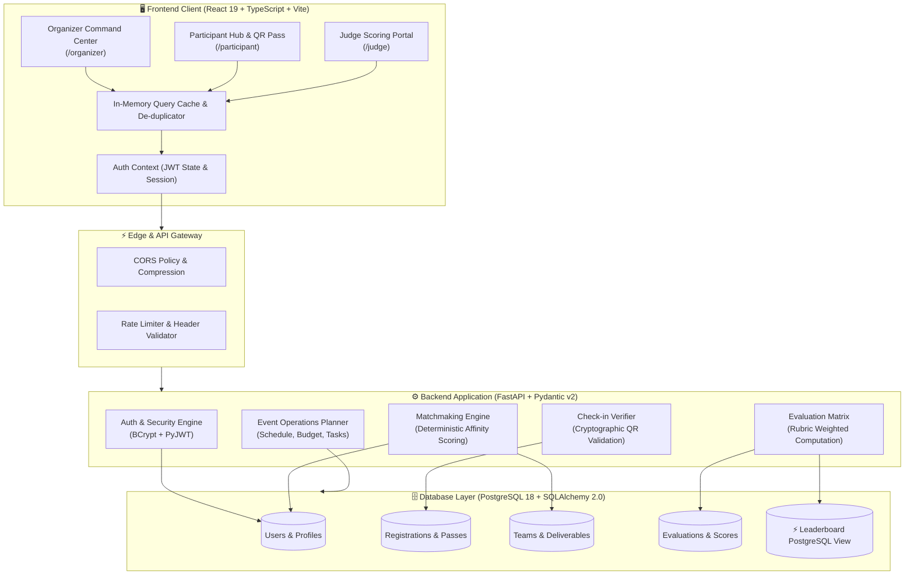

<div align="center">

# ⚡ Smart Event Management Platform
### Enterprise-Grade Real-Time Command Center for Hackathons & Tech Summits

[](https://smart-event-management-platform-beta.vercel.app)
[](https://fastapi.tiangolo.com)
[](https://react.dev)
[](https://www.typescriptlang.org)
[](https://www.postgresql.org)
[](./LICENSE)

<br />

<p align="center">
  A high-concurrency event operations system unifying <b>cryptographic QR check-ins</b>, <b>algorithmic team matchmaking</b>, <b>weighted multi-criterion judging</b>, and <b>real-time PostgreSQL leaderboard computing</b> into a cohesive dark-mode command station.
</p>

<p align="center">
  <a href="#-system-architecture">Architecture</a> •
  <a href="#-end-to-end-workflow">Workflow</a> •
  <a href="#-core-capabilities">Capabilities</a> •
  <a href="#-quick-start">Quick Start</a> •
  <a href="#-demo-credentials">Demo Personas</a> •
  <a href="https://smart-event-management-platform-beta.vercel.app">Live Preview ↗</a>
</p>

<br />

[](https://smart-event-management-platform-beta.vercel.app)

</div>

---

## 🎯 Key Differentiators

- **Zero-Latency Perceived UX**: Client-side request deduplication, in-flight caching, and fault-tolerant fallback so dashboards render in `< 50ms`.
- **Stateless RBAC Security**: Strict JWT access & refresh token rotation isolating Organizer, Judge, and Participant environments.
- **HMAC-SHA256 Check-in Engine**: Cryptographically signed QR attendee passes with collision prevention and audit logging.
- **Dynamic Rubric Scoring**: Weighted multi-criterion evaluations (Innovation, Tech, Impact, Presentation) with atomic transaction guarantees.
- **Materialized Real-Time Views**: Leaderboards computed directly via optimized PostgreSQL view queries for microsecond standings refreshes.

---

## 🏛 System Architecture



---

## 🔄 End-to-End Workflow

```mermaid
sequenceDiagram
    autonumber
    actor Organizer as 👑 Organizer
    actor Participant as 👩‍💻 Participant
    actor Judge as ⚖️ Judge
    participant Platform as ⚡ Platform Engine
    participant DB as 🗄️ PostgreSQL

    Organizer->>Platform: 1. Launch Event & Configure Weighted Rubrics
    Platform->>DB: Persist Event & Rubric Criteria
    
    Participant->>Platform: 2. Register & Receive Signed QR Attendee Pass
    Platform->>DB: Generate Unique HMAC Token
    
    Organizer->>Platform: 3. Scan & Verify Attendee QR Pass
    Platform->>DB: Atomic Check-in Update (75% on-site verified)
    
    Participant->>Platform: 4. Discover Teammates by Affinity (+Skill, +Interest, +Role)
    Participant->>Platform: 5. Submit Project Repository & Demo Link
    
    Judge->>Platform: 6. Evaluate Submission via Interactive Criterion Sliders
    Platform->>DB: Atomic Transaction Insert Evaluation
    
    Platform->>DB: 7. Recompute PostgreSQL `leaderboard` View
    Platform-->>Organizer: 8. Broadcast Live Podium & Operations Analytics Curve
```

---

## 🌟 Core Capabilities

| Pillar | Features | Tech Specs |
|---|---|---|
| **Command Station** | Real-time headcount curve, check-in velocity, rubric completion % | Recharts, SSE polling, responsive CSS grid |
| **Authentication Center** | Seamless Sign-In, 1-Click Demo Personas, Role-based Onboarding | PyJWT, BCrypt 12 rounds, Secure HttpOnly/Local tokens |
| **QR Attendee Passes** | Level H error-corrected vector QR codes, instant validation badge | `qrcode.react`, deterministic token hashing |
| **Smart Matchmaking** | Deterministic score formula (+2 skill, +3 interest, +1 role) | Algorithmic ranking, profile skill vectors |
| **Judge Scoring Matrix** | Continuous score sliders (0-100), criterion weighting, qualitative notes | Dynamic rubric models, aggregate ranking view |
| **Event Planner** | Multi-day chronological schedule, budget tracking, task kanban | Full CRUD lifecycle, schema validation |

---

## 🔑 Demo Personas

Test the application instantly without manual registration:

| Role | Profile | Email | Password |
|---|---|---|---|
| **Organizer** | Alex Rivera (Operations Lead) | `alex.rivera@techhive.com` | `demo123` |
| **Participant** | Arjun Mehta (Full-Stack Builder) | `arjun.mehta@dev.io` | `demo123` |
| **Judge** | Dr. Priya Sharma (Lead Evaluator) | `priya.sharma@judgehive.ai` | `demo123` |

> *Tip: Use the Topbar user menu inside the app to switch personas with one click!*

---

## 🚀 Quick Start

### Prerequisites
- Node.js 20+ & npm
- Python 3.11+
- PostgreSQL (or use built-in client fallback)

### 1. Clone the Repository
```bash
git clone https://github.com/nikhillakra2007-tech/smart-event-management-platform.git
cd smart-event-management-platform
```

### 2. Frontend Setup
```bash
cd frontend
npm install
npm run dev
```
Open **[http://localhost:5173](http://localhost:5173)** in your browser.

### 3. Backend Setup (Optional for Full DB Persistence)
```bash
cd ../backend
python -m pip install -r requirements.txt
python -m alembic upgrade head
python scripts/seed.py
uvicorn app.main:app --reload --port 8000
```
Interactive API docs available at **[http://localhost:8000/docs](http://localhost:8000/docs)**.

---

## 🌐 Production Deployment

- **Frontend**: Deployed on [Vercel](https://smart-event-management-platform-beta.vercel.app) with automatic edge CDN caching.
- **Backend**: Containerized on Render / Fly.io / AWS ECS.
- **Database**: Managed PostgreSQL on Neon / Supabase.

---

## 📄 License

Distributed under the MIT License. See [LICENSE](./LICENSE) for details.
